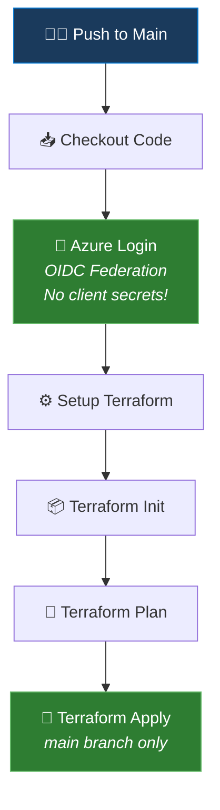

<div align="center">

# 🔄 Terraform + GitHub Actions — Azure CI/CD Pipeline

[](https://github.com/features/actions)
[](https://www.terraform.io/)
[](https://azure.microsoft.com/)

**Production-grade Terraform CI/CD pipeline using GitHub Actions with OIDC authentication to Azure — no secrets stored, fully automated.**

</div>

---

## 🏗️ Pipeline Architecture



## 🔐 OIDC Authentication — Zero Secrets

This pipeline uses **Workload Identity Federation (OIDC)** instead of storing Azure service principal secrets:

```yaml
permissions:
  id-token: write    # Required for OIDC token request
  contents: read

- name: Azure Login using OIDC
  uses: azure/login@v2
  with:
    client-id: ${{ secrets.AZURE_CLIENT_ID }}
    tenant-id: ${{ secrets.AZURE_TENANT_ID }}
    subscription-id: ${{ secrets.AZURE_SUBSCRIPTION_ID }}
```

**Why OIDC?**
| Traditional (Client Secret) | OIDC Federation |
|:--|:--|
| ❌ Secrets stored in GitHub | ✅ No secrets at all |
| ❌ Secrets expire & need rotation | ✅ Token generated per-run |
| ❌ Secret sprawl risk | ✅ Trust relationship only |
| ❌ Potential for secret leaks | ✅ Cryptographically verified |

## 📁 Project Structure

```
terraform-github-actions/
├── .github/
│   └── workflows/
│       └── terraform.yaml    # CI/CD pipeline definition
├── main.tf                   # Azure resource definitions
├── providers.tf              # AzureRM provider + version pinning
├── .gitignore                # Excludes .terraform/, *.tfstate, tfplan
└── README.md
```

## 🚀 What It Deploys

```hcl
resource "azurerm_resource_group" "example" {
  name     = "rg-github-terraform-demo"
  location = "Central India"
}
```

> This is a **starter template** — extend it with modules for VNets, AKS clusters, Key Vaults, and more.

## ⚙️ Setup Guide

### 1. Create Azure OIDC Federation

```bash
# Create App Registration
az ad app create --display-name "github-terraform-oidc"

# Create Federated Credential
az ad app federated-credential create --id <APP_ID> --parameters '{
  "name": "github-main",
  "issuer": "https://token.actions.githubusercontent.com",
  "subject": "repo:rahulgoyaldevops/terraform-github-actions:ref:refs/heads/main",
  "audiences": ["api://AzureADTokenExchange"]
}'

# Create Service Principal & assign Contributor role
az ad sp create --id <APP_ID>
az role assignment create --assignee <APP_ID> --role Contributor --scope /subscriptions/<SUB_ID>
```

### 2. Add GitHub Secrets

| Secret Name | Value |
|:--|:--|
| `AZURE_CLIENT_ID` | App Registration Application (client) ID |
| `AZURE_TENANT_ID` | Azure AD Tenant ID |
| `AZURE_SUBSCRIPTION_ID` | Target Azure Subscription ID |

### 3. Push & Watch It Run

```bash
git push origin main
# Pipeline triggers automatically → Init → Plan → Apply
```

## 🗺️ Roadmap — Extending This Pipeline

- [ ] Add `terraform validate` and `tflint` linting stage
- [ ] Add `checkov` / `tfsec` security scanning
- [ ] Add `infracost` cost estimation as PR comment
- [ ] Add manual approval gate before `terraform apply`
- [ ] Add `terraform plan` output as PR comment
- [ ] Add drift detection on schedule (cron)
- [ ] Add Terraform state backend (Azure Storage with encryption)
- [ ] Add branch protection + required status checks

---

<div align="center">

**Built by [Rahul Goyal](https://github.com/rahulgoyaldevops)** — Enterprise Cloud Architect | 14+ Years

</div>